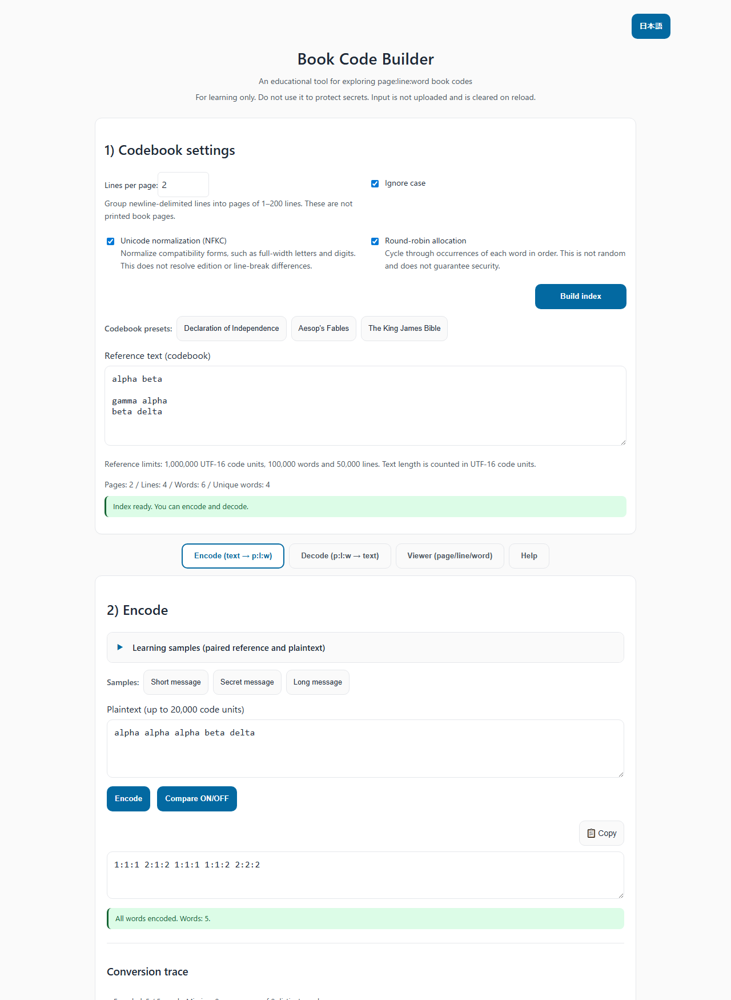
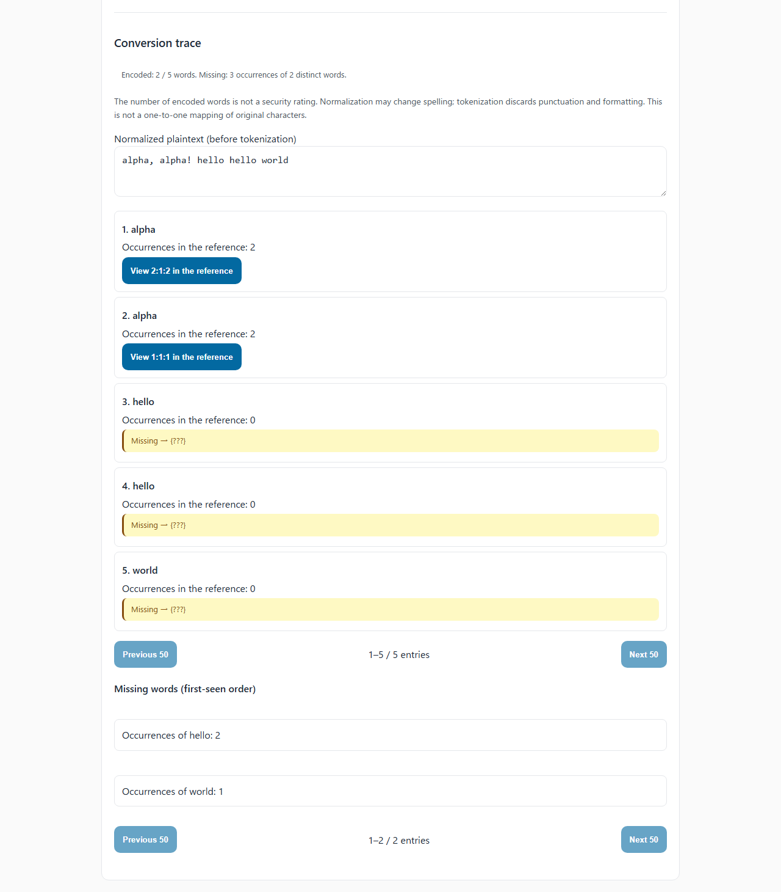
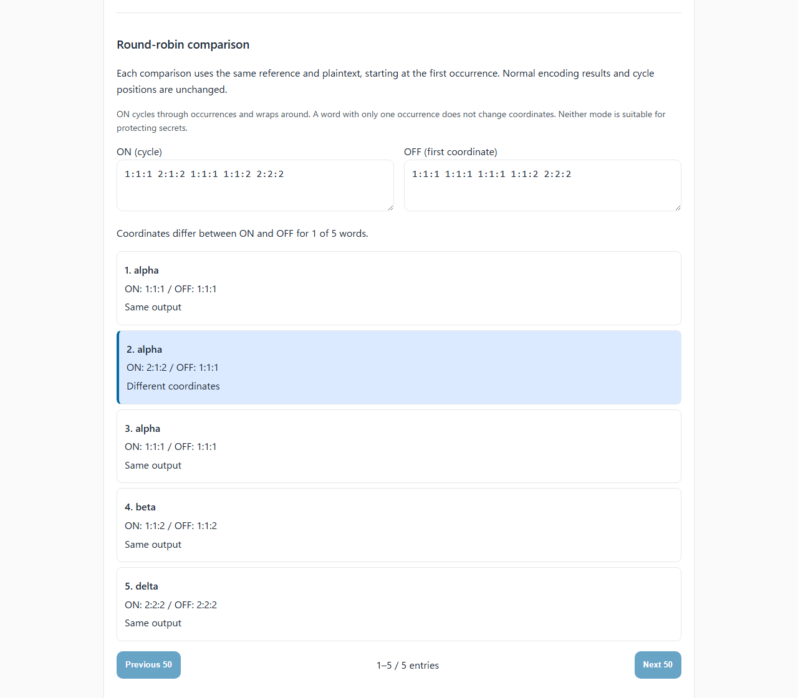
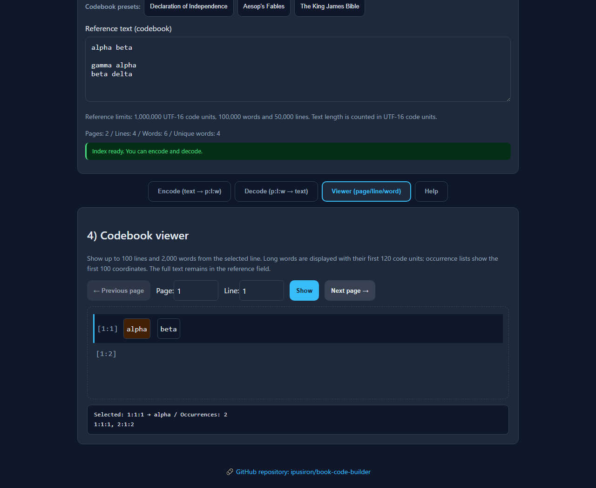

<!--
---
id: day099
slug: book-code-builder

title: "Book Code Builder"

subtitle_ja: "書籍暗号支援ツール"
subtitle_en: "Historical Book Code Simulator"

description_ja: "歴史的な書籍暗号（Book Code）を体験できる教育用ツール。任意のテキストをコードブックとして、平文をpage:line:word座標に暗号化・復号できます。"
description_en: "Educational tool for exploring historical book codes. Encode plaintext into page:line:word coordinates using any text as a codebook, and decode coordinates to normalized words."

category_ja:
  - 古典暗号
  - コード
category_en:
  - Classical Cryptography
  - Code Cipher

difficulty: 3

tags:
  - book-code
  - cipher
  - cryptography
  - historical
  - education
  - javascript

repo_url: "https://github.com/ipusiron/book-code-builder"
demo_url: "https://ipusiron.github.io/book-code-builder/"

hub: true
---
-->

# Book Code Builder - Historical Book Code Simulator

English | [日本語](README.md)

[](https://github.com/ipusiron/book-code-builder)
[](https://github.com/ipusiron/book-code-builder)


[](https://ipusiron.github.io/book-code-builder/)

Day099 of the “100 Security Tools Built with Generative AI” project: an educational tool for exploring book codes.

Use any reference text as a codebook to encode plaintext words as `page:line:word` coordinates.
For example, `12:5:3` means the third word on the fifth line of page 12. Pages group newline-delimited lines using a specified line count; they are not printed book pages.

**Do not use this tool to protect secrets.** A long book or round-robin allocation does not make it secure encryption.
Decoding returns normalized words, not the original punctuation, line breaks or extra whitespace.

## 🌐 Live demo

[Open Book Code Builder](https://ipusiron.github.io/book-code-builder/).
Switch the display language using the button at the top right.
[Open in Japanese](https://ipusiron.github.io/book-code-builder/?lang=ja) /
[Open in English](https://ipusiron.github.io/book-code-builder/?lang=en).

Input and conversion are handled in your browser. The app does not implement input uploads, external analysis APIs or analytics.
Normal HTTP requests fetch the page, scripts and preset files.

## 📸 Screenshots



The English encoding screen in the light theme.



Inspect normalized plaintext, each word's coordinate and missing-word counts.



Compare from the first occurrence without changing normal cycle positions.



Select a word to inspect its occurrence count and coordinates. The dark theme follows your system setting.

## 👥 Intended users

- Students, teachers and independent learners: follow the word-to-coordinate mapping by hand
- Readers interested in cryptographic history: explore a book-based method and its operational constraints
- Researchers and security engineers: observe repeated coordinates and their distribution under chosen conditions
- CTF participants and authors: create and check exercises with identical text and counting rules
- Programmers: inspect three-dimensional arrays, inverted indexes and state management

Basic browser skills are sufficient. The examples use English, but Unicode letters and numbers are accepted.
This is not a linguistic segmentation tool or an attack-success measurement tool.

## 💡 Usage scenarios

Ways of using this tool in particular:

- Learning about search preprocessing: in the Spelling and punctuation sample, `ＡＬＰＨＡ, Alpha!` becomes 2 occurrences of `alpha`. Distinguish spelling normalization from punctuation removal; this does not restore the original text.
- Preparing vocabulary exercises: the Missing words sample encodes only 1 of 6 words, with 5 missing occurrences of 2 distinct words. Check whether a reference contains the words you need; synonyms and meaning are not evaluated.
- Learning cyclic allocation: the Repeated words comparison changes the coordinate for only 1 of 5 words between ON and OFF. Observe how a finite set wraps around; this is not an evaluation of randomness or fair load balancing.

### Scenario 1: A classroom exercise

Work through coordinate counting, multiple occurrences of one word and missing vocabulary.

1. Read the Help sections on the basics and mechanism (an example allocation of 15 minutes).
2. Enter the “Small reproducible example” below, then encode, sync and decode (20 minutes).
3. Rebuild the index and compare round-robin on and off (15 minutes). Also try a word with only one occurrence.
4. Add `omega` to the plaintext and check that the missing word produces `{???}` (10 minutes).
5. Select `alpha` in the viewer and inspect its two coordinates and line numbers (15 minutes).

These times are suggestions for lesson planning, not measured durations.
The plaintext samples, including Short message, demonstrate vocabulary limitations. Not every word is guaranteed to exist in every book.

### Scenario 2: Observing statistical properties of a classical code

Record the text, line breaks, lines per page, normalization settings and cycle-reset procedure so that the conditions can be reproduced.

1. Compare the page, line, word and unique-word counts for the three presets.
2. Choose plaintext whose words exist in each book, then count coordinate occurrences with round-robin off.
3. Rebuild and repeat with round-robin on to compare repetition. Words with only one occurrence still use the same coordinate.
4. Inspect a selected word's occurrence count and displayed coordinates. The viewer lists only the first 100; use the core's `index` for a separate full-distribution analysis.
5. Try word sequences such as `of the` and observe repeated coordinate pairs. First check that the chosen book contains the words.

Frequency tables, page-distribution charts, n-gram analysis, the index of coincidence and attack-success calculations are not built in.
They require separate analysis of copied results or the data from `core.js`. Fewer repeated coordinates alone do not demonstrate greater resistance to attacks.

### Scenario 3: Creating and solving CTF exercises

Example challenge: “Using the small reference text below, two lines per page, Ignore case on and NFKC on, decode `2:1:1 1:1:1 2:2:2`.”

The answer is `gamma alpha delta`.
If the required flag is `flag{gamma_alpha_delta}`, separately specify the submission rule: join the three decoded words with underscores and wrap them in `flag{}`.
The tool itself does not restore braces or underscores.

- Authors: distribute the reference file and settings, then verify the answer by actually decoding it
- Solvers: use identical text and line breaks, build the index, then enter the coordinates
- If `[?]` appears: check coordinate syntax and range, as well as the text, lines per page and normalization settings
- Further exercises: explore different line breaks or page lengths, missing words and missing coordinates
- Exercises needing separate implementations: different books for different pages, or combinations with other ciphers

A book title alone does not specify its edition or line breaks. Round-robin on/off alone is not a difficulty rating.

## 📜 Historical background

The correspondence between Arnold and André during the American Revolutionary War is an example of book-based encipherment.
Friedman's lecture material published by the NSA describes methods using dictionaries and books such as Blackstone.
This tool does not reproduce their books, ciphertext or counting conventions.
Source: [SCAMP lecture material, PDF page 18](https://www.nsa.gov/Portals/75/documents/news-features/declassified-documents/friedman-documents/lectures-speeches/FOLDER_023/41699799073912.pdf#page=18).

Being able to carry a book is not the same as securely sharing a secret key.
Matching coordinates requires identical text and counting rules.

## 🔐 Properties and limitations of book codes

### Benefits and operational challenges

| Aspect | What can be learned / constraint |
|---|---|
| Procedure | Follow the word-to-coordinate conversion without complex arithmetic |
| Vocabulary | Words absent from the book cannot be encoded |
| Edition and line breaks | The same title does not guarantee matching text, line breaks or coordinates |
| Repeated words | A word may have several coordinates, but each coordinate identifies exactly 1 word |
| Length | The coordinate count reveals the plaintext token count; character length may increase or decrease |
| Distribution and updates | Participants must share and check the book and settings; a public book is not a secret random key |

Multiple occurrences of the same word do not, by themselves, make decoding ambiguous.
However, a coordinate within the bounds of a different book can return a different word without a warning.
There is no authentication of the text, its integrity or the sender.

### A cryptographic perspective

With round-robin off, each plaintext word is replaced by a fixed coordinate.
With it on, words that have multiple coordinates cycle through them. In this sense the method resembles word-level homophonic substitution, but coordinate selection is deterministic.

Observable clues include coordinate frequencies, repetitions, ranges and known plaintext-coordinate pairs.
How much a particular method can recover depends on the reference text, plaintext, available information and evaluation conditions.
An unknown book does not imply impossibility of decoding, nor do “infinitely many candidates” establish that brute-force search is impossible.

### Differences from modern cryptography

This tool has no secret random keys, nonces, authentication tags, tamper detection or validation against a standard protocol.
Public-key cryptography does not automatically solve every key-distribution problem, and the names AES or RSA alone do not imply a mathematical proof of an entire implementation's security.
Do not extend this demo into a system for protecting secrets.

### Learning about statistical bias

Word counts and positions depend on a book's content.
Compare frequent words, names concentrated in a chapter and words occurring only once to observe round-robin behavior.

- One occurrence: the same coordinate with round-robin on or off
- Two occurrences: round-robin alternates between the two positions
- A word concentrated on certain pages: cycling never leaves those pages
- Reusing the same text: mappings and ordering clues may recur

When studying frequency ranks in relation to Zipf's law, calculate them from the actual text.
Do not apply fixed percentages to every English text or turn the unique-word ratio into a security score.
A long book, a dictionary or varied vocabulary does not guarantee security.

## ⚙️ Features

- Build an index from any reference text and convert between `p:l:w` coordinates and normalized word sequences
- Three book presets, three plaintext samples, lines-per-page and normalization settings
- Round-robin on/off, missing-word and invalid-coordinate notices
- Actual conversion traces, missing-word occurrence and distinct-word counts, and independent ON/OFF comparison
- 4 paired reference/plaintext learning samples with a preview before loading
- Page, line, word and unique-word counts; line selection; word occurrence counts and coordinates
- Invalidate results when their inputs or settings change, and prevent stale loading responses
- Sync ciphertext and report clipboard success, failure or lack of support
- Japanese/English switching, keyboard controls, system theme support and narrow-screen layouts
- Collapsible help and dependency-free computation and tests

## 📖 Usage

### Basic workflow

1. Set the reference text. Over HTTP, the first preset loads automatically, but input edited while loading is not overwritten.
2. Choose Lines per page (1–200, initially 40) and normalization options, then click Build index.
3. Enter plaintext in the Encode tab and encode it. Missing words are shown as `{???}`.
4. In the Decode tab, enter coordinates or use ↓ Sync to load the encoded result.
5. Decode. Invalid syntax and out-of-range coordinates produce `[?]`. Separate coordinates with whitespace, line breaks, commas or semicolons.
6. In the viewer, choose a page and line, then click Show. Select words by clicking or using the keyboard.

Changing the reference text, lines per page or normalization invalidates the index and both results. Conversion is disabled until rebuilding.
Editing plaintext or ciphertext, loading a plaintext sample or syncing clears the corresponding stale result.
A failed book load preserves the reference text, but the index must be rebuilt.

### Learning samples and conversion traces

Learning samples in the Encode tab are expanded initially.
Select a sample, review its reference, plaintext and settings, then click Load this sample.
Selection alone does not change inputs. Cancel preserves the current inputs and results.
Confirming replaces the reference and plaintext, sets 2 lines per page, and turns Ignore case, NFKC and round-robin ON.
It clears the decoding input, all results and cycle positions, then builds the index.

| Sample | Result to inspect |
|---|---|
| Encode all words | All 4 words encoded |
| Repeated words | Of 5 words, 1 has different coordinates between ON and OFF |
| Missing words | Of 6 words, 1 is encoded. Missing: 5 occurrences of 2 distinct words. hello occurs 2 times and world 3 times |
| Spelling and punctuation | After normalization and tokenization: 3 words, alpha, alpha, beta |

Encode displays normalized plaintext and each word's occurrence count and selected coordinate.
Coordinate buttons open the corresponding word in the viewer.
Missing words are grouped in first-seen order. The number of encoded words is not a security rating.
Each list shows 50 entries per page; use the previous/next buttons to inspect every entry.

### Round-robin comparison

Compare ON/OFF uses the current reference and plaintext, starting both modes at the first occurrence every time.
It does not change normal encoding results or cycle positions. Its starting position may differ from repeated normal encodings.
Differences are marked with both color and the label Different coordinates.
A word with 1 occurrence always uses the same coordinate; cycling wraps around. This is not a security score.

Changing the reference, settings or plaintext clears the learning views. Language switching preserves results without recalculating.
JSON saving/loading, automatic replacement and linguistic segmentation are not implemented.

### Small reproducible example

Enter these four lines as the reference text. The second line is empty; do not add a line break after the fourth line.

```text
alpha beta

gamma alpha
beta delta
```

Build the index with two lines per page, both normalization options on and round-robin on.
The statistics are 2 pages, 4 lines, 6 words and 4 unique words.
The first encoding of `alpha alpha alpha beta delta` is:

```text
1:1:1 2:1:2 1:1:1 1:1:2 2:2:2
```

Syncing and decoding returns `alpha alpha alpha beta delta`.
Rebuild the index to reset cycle positions before repeating the example under the same conditions.

### Language and keyboard controls

Language priority is the URL's `?lang=ja` / `?lang=en`, a saved selection, then the browser language.
Browser languages other than Japanese select English. Switching still works for the current page if storage is unavailable.
Switching preserves the reference text, inputs, results, index, cycle positions and viewer selection.

| Control | Keys |
|---|---|
| Tabs | Left/Right arrows to move, Home for first, End for last |
| Buttons and words | Tab to move, Enter or Space to activate |
| Lines per page field | Enter to build the index |
| Viewer page and line fields | Enter to display |
| Plaintext and ciphertext fields | Ctrl+Enter / Cmd+Enter to convert |

Copying uses the browser's Clipboard API. Unsupported access, permission denial and timeouts are reported.
If copying fails, select the result field and copy it manually.

### Running locally

Opening `index.html` directly with `file://` provides the built-in sample and manual input. It does not load the three file-based book presets.
To use those books, run the following command in the repository root and open `http://127.0.0.1:8000/`.

```sh
python -m http.server 8000 --bind 127.0.0.1
```

No build or package installation is required. Stop the server with Ctrl+C.
The public demo uses HTTPS. Local-file and clipboard permissions vary between browsers.

### Adding codebook presets

Place a UTF-8 `.txt` file in `data/` and add an entry to `codebooks` in `manifest.json`.
`id`, `title` and `filename` are required. Descriptions and sources are management metadata, not tooltips.
Add localized button titles to `books` in `messages.js`.
See [data/README.md](data/README.md) for format, size and rights-notice requirements (in Japanese).

## 🔧 Technical specification

### Counting pages and words

1. Apply NFKC, then lowercase conversion, according to the settings.
2. Split on LF, CRLF or CR. Count empty lines, including an empty line created by a trailing line break.
3. Group lines into logical pages of the specified length.
4. Extract tokens from each line with `/[\p{L}\p{N}]+(?:[-'][\p{L}\p{N}]+)*/gu`.
5. Record page, line and word coordinates, all counted from 1.

`don't` and `co-operate` are each one token. `don’t` splits into `don` and `t`.
Continuous Japanese text is treated as one token, without linguistic segmentation. Combining marks are not included in the regular expression, so marks remaining after NFKC may split tokens.
`flag{book_code}` is not preserved as one token with its punctuation.

NFKC normalizes compatibility-equivalent representations; it is more than full-width/half-width conversion. Some distinctions in representation are lost.
Specification: [Unicode UAX #15](https://www.unicode.org/reports/tr15/).

The number of words per line is not fixed. Visual wrapping does not affect coordinates; actual line breaks do.
Input and display limits are defined separately below.

### Input, output and display limits

Text lengths are measured in UTF-16 code units. When normalization expands text, the length limit is also checked after normalization.

| Item | Limit |
|---|---:|
| Reference text | 1,000,000 code units |
| Reference words | 100,000 words |
| Reference lines | 50,000 lines |
| Plaintext input | 20,000 code units |
| Ciphertext input and output | 100,000 code units |
| Decoded output | 1,000,000 code units |
| 1 conversion | 10,000 words or 10,000 coordinates |
| Lines per page | 1–200 |
| Viewer | Up to 100 lines and 2,000 words from the selected line |
| Long-word display | First 120 code units plus an ellipsis |
| Occurrence-coordinate display | First 100 entries |
| Preset list | 50 entries |

Input or output exceeding a limit is rejected; no partial success result is returned.
Viewer truncation affects display only, not index totals. Check omitted content in the reference field.
Computation runs on the main thread. Even within the limits, processing time depends on the device; an unresponsive page cannot be ruled out.

### Round-robin behavior

Occurrences of each word are used in their recorded order.
In the small example, `alpha` cycles through `1:1:1 → 2:1:2 → 1:1:1`.
With round-robin off, it always uses the first coordinate, `1:1:1`. No randomness is involved.

Words with a single occurrence, or conditions that complete a full cycle, can produce the same ciphertext.
Repeated encoding does not necessarily produce a different result every time.

- Index invalidation/rebuilding, toggling on/off or reloading: reset cycle positions
- Plaintext editing and subsequent encoding: retain the built index's cycle positions
- Language switching, decoding or viewing: do not change cycle positions
- Failed conversions, including limit errors: do not advance cycle positions

The decoder does not need the encoder's cycle positions. It looks up each coordinate in the same reference text under the same settings.
Round-robin merely spreads frequency across coordinates; it guarantees neither perfect secrecy nor resistance to attacks.

### Security and privacy

User-derived strings are displayed through `textContent`, text nodes and `textarea.value`, never interpreted as HTML.
The CSP allows same-origin scripts, styles and connections, and same-origin or data-URL images.
Book filenames, manifest structure, size and time limits are checked; redirects are rejected.

The page specifies `no-referrer`.
`X-Content-Type-Options` is an HTTP response header; it is not treated as configured through an HTML meta tag.
This does not guarantee all hosting headers or complete protection against every form of XSS.
Source: [MDN's header documentation](https://developer.mozilla.org/en-US/docs/Web/HTTP/Reference/Headers/X-Content-Type-Options).

Only the selected display language is stored. The reference text, inputs and results are not persisted.
Reloading resets the app's inputs, but does not erase the clipboard or records made by browser features, extensions or the operating system.

## ⚠️ Operational limits and responsible use

The same book or title alone does not ensure compatible decoding.
Share identical text, line breaks, lines per page, normalization settings and tokenization rules.
The missing-word marker `{???}` contains no information about the original word and cannot restore it during decoding.

The tool does not automatically break codes, score security or detect tampering.
Use it for lessons, small research experiments and practice with texts whose usage rights you have checked.

## 📁 Directory structure

```text
book-code-builder/
├── .github/
│   └── workflows/
│       └── test.yml          # Node.js 22 tests
├── .gitignore
├── .nojekyll
├── assets/
│   ├── en/
│   │   ├── screenshot.png
│   │   ├── screenshot-learning.png
│   │   ├── screenshot-compare.png
│   │   └── screenshot-viewer.png
│   ├── screenshot.png
│   ├── screenshot-learning.png
│   ├── screenshot-compare.png
│   └── screenshot-viewer.png
├── data/
│   ├── manifest.json
│   ├── README.md
│   ├── Aesop's Fables.txt
│   ├── The King James Version of the Bible.txt
│   └── United States Declaration of Independence.txt
├── test/                     # Core, state, translation, docs and color checks
├── CLAUDE.md
├── core.js                   # DOM-independent computation
├── i18n.js                   # Language selection and static text
├── index.html
├── learning-samples.js       # Paired reference/plaintext learning samples
├── LICENSE
├── messages.js               # Dynamic messages
├── package.json
├── README.md
├── README.en.md
├── script.js                 # Input, loading and display state
├── static-messages.js        # Static UI English translations
├── style.css
└── TECHNICAL.md
```

## 👨‍💻 Development and testing

Run the tests on Node.js 22 or later without installing dependencies.

```sh
npm test
```

Regression tests cover worked examples, round trips, normalization, limits, bundled text data, state invalidation, copying, translations, bilingual documentation and colors.
GitHub Actions runs the same tests on push and pull_request.

Browser checks cover Chromium and Firefox, HTTP and file URLs, Japanese and English, light/dark themes, and widths of 320, 390, 768 and 1280px.
Safari, physical devices and screen readers have not been tested.
See [TECHNICAL.md](TECHNICAL.md) for APIs, state transitions, complexity and CSP handling (in Japanese).

## 📄 License

Application code is licensed under the [MIT License](LICENSE).
For bundled texts, check the notices within each file and [data/README.md](data/README.md).
The application's MIT license does not automatically apply to every text.

## 🛠️ About this tool

This tool was developed as Day099 of the “100 Security Tools Built with Generative AI” project.
The project uses AI assistance to create and publish security-related tools over 100 days.

[Project details and other tools](https://akademeia.info/?page_id=42163)
