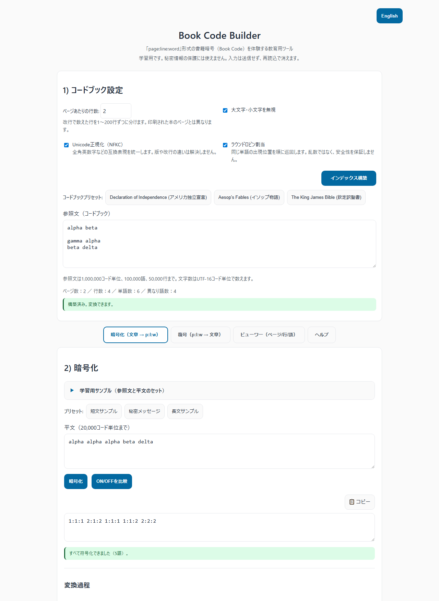
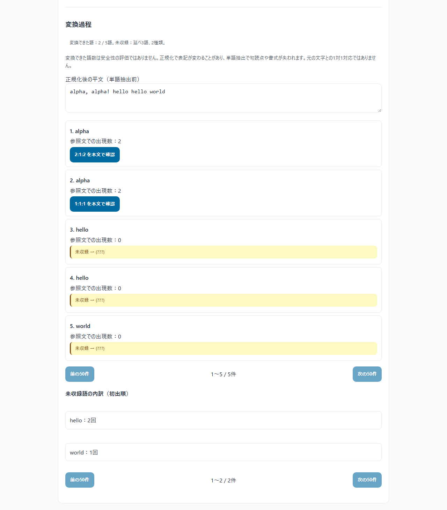
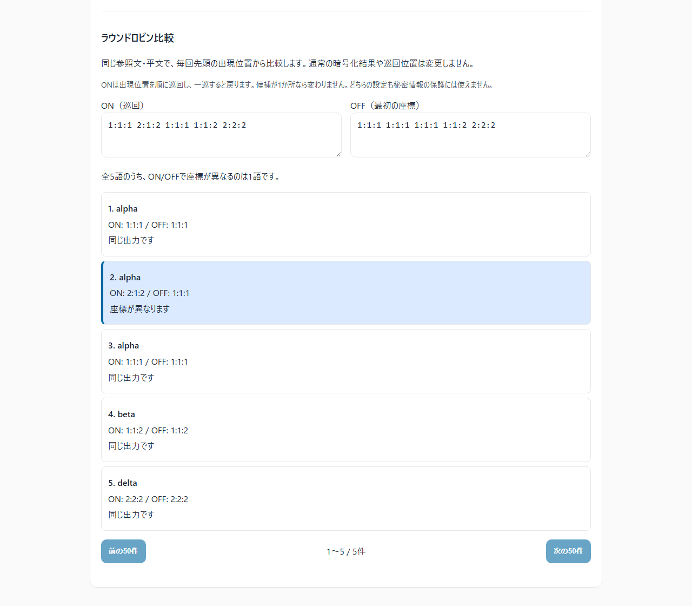
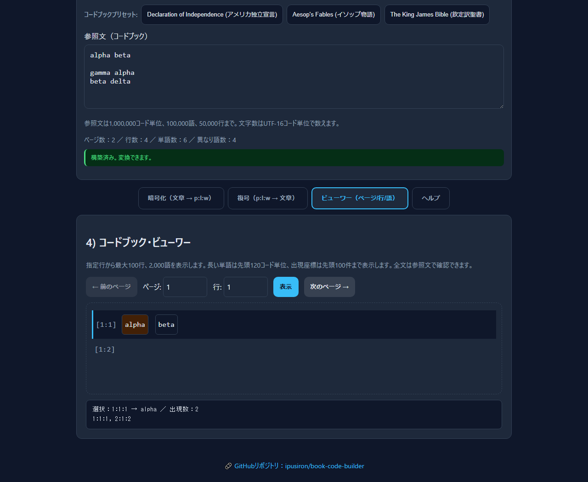

<!--
---
id: day099
slug: book-code-builder

title: "Book Code Builder"

subtitle_ja: "書籍暗号支援ツール"
subtitle_en: "Historical Book Code Simulator"

description_ja: "歴史的な書籍暗号（Book Code）を体験できる教育用ツール。任意のテキストをコードブックとして、平文をpage:line:word座標に暗号化・復号できます。"
description_en: "Educational tool for exploring historical book codes. Encode plaintext into page:line:word coordinates using any text as a codebook, and decode coordinates to normalized words."

category_ja:
  - 古典暗号
  - コード
category_en:
  - Classical Cryptography
  - Code Cipher

difficulty: 3

tags:
  - book-code
  - cipher
  - cryptography
  - historical
  - education
  - javascript

repo_url: "https://github.com/ipusiron/book-code-builder"
demo_url: "https://ipusiron.github.io/book-code-builder/"

hub: true
---
-->

# Book Code Builder - 書籍暗号支援ツール

[English](README.en.md) | 日本語

[](https://github.com/ipusiron/book-code-builder)
[](https://github.com/ipusiron/book-code-builder)


[](https://ipusiron.github.io/book-code-builder/)

Day099：「生成AIで作るセキュリティツール100」の書籍暗号を体験する教育用ツールです。

任意のテキストをコードブックとして、平文の単語を `page:line:word` の座標に変換します。
たとえば `12:5:3` は「12ページ目の5行目の3語目」です。ページは改行で数えた行を指定行数ずつにまとめたもので、印刷された本のページではありません。

**秘密情報の保護には使えません。** 長い本やラウンドロビンを使っても、安全な暗号にはなりません。
復号するのは正規化後の単語列です。句読点、元の改行、余分な空白は復元しません。

## 🌐 デモページ

[Book Code Builderを開く](https://ipusiron.github.io/book-code-builder/)。
表示言語は右上のボタンで切り替えられます。
[日本語で開く](https://ipusiron.github.io/book-code-builder/?lang=ja) /
[英語で開く](https://ipusiron.github.io/book-code-builder/?lang=en)。

入力と変換処理はブラウザー内で扱います。入力のアップロード、解析用の外部API、アクセス解析は実装していません。
ページ、スクリプト、プリセットの取得には通常のHTTP通信を使います。

## 📸 スクリーンショット



日本語・ライトテーマの暗号化画面です。



正規化後の平文、各語の座標、未収録語の内訳を確認できます。



通常の巡回位置を変更せず、先頭位置から比較します。



単語を選択し、出現数と座標を確認する画面です。ダークテーマはOS設定に追従します。

## 👥 対象ユーザー

- 暗号学を学ぶ学生、教員、独学者：単語と座標の対応を手で確認する用途
- 暗号史に関心がある方：本を参照する方式と運用上の制約を体験する用途
- 研究者、セキュリティエンジニア：自分で用意した条件で、座標の繰り返しや分布を観察する用途
- CTF参加者・出題者：同一の本文と数え方を共有した練習問題の作成・確認
- プログラマー：3次元配列、逆引き索引、状態管理の実装を読む用途

基本的なブラウザー操作ができれば使えます。英語の例を使いますが、Unicodeの文字と数字を扱えます。
形態素解析や攻撃成功率の測定を行うツールではありません。

## 💡 活用シナリオ

このツールならではの使い方：

- 検索処理を学ぶ人：学習サンプル「表記と句読点」を変換すると、`ＡＬＰＨＡ, Alpha!`は2語の`alpha`になる。表記の統一と句読点の除去を区別する練習であり、文章を元どおりに戻す処理ではない。
- 語彙教材を作る人：「未収録語」のサンプルで、6語中1語だけが変換でき、未収録は延べ5語・2種類と確認する。本文に必要な語があるかを確かめられるが、同義語や文章の意味は判定しない。
- 順番に割り当てる処理を学ぶ人：「同じ単語の繰り返し」の比較で、5語中1語の座標だけがON/OFFで異なることを確認する。有限の候補を一巡すると戻る例であり、乱数や公平な負荷分散の評価ではない。

### シナリオ1：暗号学の授業での実習教材として

座標の数え方、同じ単語の複数の位置、未収録語を順に確認する実習です。

1. ヘルプの基本と仕組みを読む（15分の例）。
2. 下の「再現できる小さな例」を入力し、暗号化・同期・復号を行う（20分）。
3. 索引を構築し直してラウンドロビンON/OFFを比較する（15分）。単語が1カ所しかない場合も試す。
4. `omega` を平文に追加し、未収録語が `{???}` になることを確認する（10分）。
5. ビューワーで `alpha` を選び、2つの座標と行番号を確認する（15分）。

これらの時間は授業構成の例であり、実測値ではありません。
プリセットの「短文サンプル」などは語彙制限を観察するための入力例です。どの本にもすべての単語が含まれるとは限りません。

### シナリオ2：古典暗号の統計的性質の観察

同じ条件を再現できるよう、本文、改行、ページ行数、正規化設定、巡回位置のリセット方法を記録します。

1. 3冊のプリセットで、ページ数・行数・単語数・異なり語数を比較する。
2. 各本に含まれる平文を選び、ラウンドロビンOFFで座標の出現回数を数える。
3. 再構築してからONでも実行し、座標の重複を比較する。1カ所しか出ない単語はONでも同じ座標になる。
4. 選択した単語の出現数と表示座標を調べる。ビューワーは先頭100件までなので、全文の分布はコアの `index` を使って別途集計する。
5. `of the` などの連続語を使い、座標ペアの繰り返しを観察する。対象の本に語が含まれることを先に確認する。

頻度表、ページ分布のグラフ、n-gram分析、一致指数、攻撃成功率の計算は搭載していません。
コピーした結果や `core.js` を使った別の集計が必要です。座標の重複が減ったことだけで、防御力が高まったとは判定できません。

### シナリオ3：CTFでの問題作成・練習

出題例：「下の小さな参照文、ページあたり2行、大文字小文字の無視とNFKCをONにして、`2:1:1 1:1:1 2:2:2` を復号してください」。

答えは `gamma alpha delta` です。
フラグを `flag{gamma_alpha_delta}` とするなら、「復号した3語をアンダースコアでつなぎ、外側に `flag{}` を付ける」という提出規則を問題文に別途記載します。
本ツール自体は波括弧やアンダースコアを復元しません。

- 出題側：本文ファイルと設定を配布し、実際に復号して答えを検証
- 解答側：同じ本文と改行を使い、索引構築後に座標を入力
- `[?]` が出るとき：座標の形式・範囲と、本文・ページ行数・正規化設定の一致を確認
- 発展問題：改行やページ行数の違い、未収録語、欠落した座標の扱いを考察
- 別実装が必要な問題：ページごとに異なる本を使う方式や、他方式との連結

本の名前だけでは版や改行が確定しません。ラウンドロビンのON/OFFだけで難易度を採点することもできません。

## 📜 歴史的背景

書籍を参照する暗号の例として、アメリカ独立戦争期のArnoldとAndréの通信があります。
NSAが公開するFriedmanの講義資料では、辞書やBlackstoneの書籍などを使う方式が紹介されています。
本ツールは、その書籍、暗号文、当時の数え方を再現するものではありません。
出典：[SCAMP講義資料、PDFの18ページ目](https://www.nsa.gov/Portals/75/documents/news-features/declassified-documents/friedman-documents/lectures-speeches/FOLDER_023/41699799073912.pdf#page=18)。

本を手元に置けることと、秘密の鍵を安全に共有できることは別です。
実際に座標を合わせるには、同じ本文と数え方が必要です。

## 🔐 書籍暗号の特徴と限界

### 利点と運用上の課題

| 観点 | 学習できること・制約 |
|---|---|
| 手順 | 複雑な演算なしに、単語から座標への変換を追える |
| 語彙 | 本にない単語は符号化できない |
| 版と改行 | 同じ題名でも本文や改行が違えば座標が一致しない |
| 語の出現回数 | 1語が複数の座標を持つことがあるが、各座標からの逆引きは一意 |
| 長さ | 座標の個数から平文のトークン数が分かる。文字数は増える場合も減る場合もある |
| 配布と更新 | 本と設定の共有・確認が必要。公開されている本は秘密のランダム鍵ではない |

同じ単語が何度登場しても、それだけで復号が曖昧になるわけではありません。
一方、異なる本でも指定座標が範囲内なら、警告なしに別の単語が返ることがあります。
本文の一致、改ざん、送信者を認証する機能はありません。

### 暗号学的な見方

ラウンドロビンOFFでは、各平文単語を固定の座標に置き換えます。
ONでは、複数の座標を持つ単語について順に割り当てます。この意味で、単語単位の同音換字に似た性質がありますが、座標の選択は決定的です。

観察できる手掛かりには、座標の頻度、繰り返し、範囲、既知の平文と座標の対応があります。
どの手法でどれだけ復号できるかは、本文、平文、既知情報、評価条件に依存します。
本が未知なら解読不可能、候補が無限だから総当たり不可能、とはいえません。

### 現代暗号との違い

本ツールには、秘密のランダム鍵、nonce、認証タグ、改ざん検出、標準プロトコルへの適合性検証がありません。
公開鍵暗号が鍵配送のあらゆる問題を自動的に解決するわけでも、AESやRSAという名称だけで実装全体の安全性が数学的に証明されるわけでもありません。
秘密情報を扱う用途では、このデモを拡張して利用しないでください。

### 統計的な偏りの学習

単語の出現数や位置は、本の内容によって偏ります。
頻出語、特定の章に集中する固有名詞、1回しかない語を比べると、ラウンドロビンの振る舞いを観察できます。

- 出現数1：ON/OFFにかかわらず同じ座標
- 出現数2：ONでは2カ所を交互に使用
- 特定のページに集中する語：巡回してもその範囲から出ない
- 同じ本文を再利用：対応や順序の手掛かりが繰り返される可能性

Zipfの法則を題材に頻度順位を調べる場合も、実際の対象テキストから集計します。
特定の割合をすべての英文に当てはめたり、異なり語数の比率を安全度へ変換したりはしません。
長い本、辞書、多様な語彙のいずれも、安全性の保証にはなりません。

## ⚙️ 機能

- 任意の参照文から索引を構築し、`p:l:w` 座標と正規化後の単語列を相互変換
- 3冊のプリセット、3種類の平文サンプル、ページ行数と正規化の設定
- ラウンドロビンON/OFF、未収録語と不正座標の通知
- 実際の変換過程、未収録語の回数と種類数、独立したON/OFF比較
- 参照文と平文を組み合わせた4種類の学習サンプル、読み込み前の確認
- ページ数・行数・単語数・異なり語数、行指定、単語の出現数と座標表示
- 入力や設定を変えたときの結果無効化、読込競合の抑止
- 暗号文の同期、コピー成功・失敗・非対応の通知
- 日英切り替え、キーボード操作、システム連動の配色、狭い画面への対応
- 折りたたみ式ヘルプ、外部依存のない計算とテスト

## 📖 使い方

### 基本操作

1. 参照文を設定する。HTTP配信では最初のプリセットを自動読込するが、待機中に編集した入力は上書きしない。
2. ページあたりの行数（1〜200、初期値40）と正規化オプションを選び、「インデックス構築」を押す。
3. 「暗号化」タブで平文を入力し、暗号化する。未収録語は `{???}` で表示する。
4. 「復号」タブで座標を入力するか、「↓ 同期」で暗号化結果を取り込む。
5. 復号する。不正な形式や範囲外の座標は `[?]` となる。空白、改行、カンマ、セミコロンで座標を区切れる。
6. ビューワーでページと行を指定し、「表示」を押す。単語はクリックまたはキーボードで選択できる。

参照文、ページ行数、正規化を変えると索引と両方の結果を無効にします。再構築するまで変換できません。
平文・暗号文の編集、サンプル入力、同期では、対応する古い結果を消します。
読込失敗では参照文を保持しますが、再構築が必要です。

### 学習サンプルと変換過程

「暗号化」タブの「学習用サンプル」は初期状態で開いています。
サンプルを選び、参照文と平文、設定を確認して「この内容で読み込む」を押してください。
選択だけでは入力は変わりません。キャンセルすると現在の入力と結果を保持します。
読み込みを確定すると参照文と平文を置き換え、ページあたり2行、大小文字の無視・NFKC・ラウンドロビンをONにします。
復号入力とすべての結果、巡回位置を消し、索引を構築します。

| サンプル | 確認する結果 |
|---|---|
| 全語を変換 | 4語すべてを変換 |
| 同じ単語の繰り返し | 5語中1語の座標がON/OFFで異なる |
| 未収録語 | 6語中1語を変換。未収録は延べ5語・2種類。helloは2回、worldは3回 |
| 表記と句読点 | 正規化と単語抽出後はalpha、alpha、betaの3語 |

「暗号化」を押すと、正規化後の平文と、各語の出現数・今回選ばれた座標を表示します。
座標ボタンからビューワーの該当語へ移動できます。
未収録語は同じ語をまとめて初出順に表示します。変換できた語数は安全性の評価ではありません。
各一覧は50件ずつ表示し、前後のボタンですべての項目を確認できます。

### ラウンドロビン比較

「ON/OFFを比較」は現在の参照文と平文を使い、両設定を毎回先頭位置から計算します。
通常の暗号化結果と巡回位置は変更しません。連続して暗号化した結果とは開始位置が異なる場合があります。
差のある語は色と「座標が異なります」の両方で示します。
候補が1カ所なら同じ座標、一巡すれば最初の座標に戻ります。安全性の採点ではありません。

参照文・設定・平文を変えると学習表示を消します。言語変更では再計算せず、結果を保持します。
JSON保存・読み戻し、自動置換、形態素解析は実装していません。

### 再現できる小さな例

参照文に次の4行を入力します。2行目は空行、4行目の末尾には改行を追加しません。

```text
alpha beta

gamma alpha
beta delta
```

ページあたり2行、両正規化ON、ラウンドロビンONで索引を構築します。
統計は「2ページ、4行、6語、異なり4語」です。
平文 `alpha alpha alpha beta delta` の初回の暗号化結果は次のとおりです。

```text
1:1:1 2:1:2 1:1:1 1:1:2 2:2:2
```

同期して復号すると `alpha alpha alpha beta delta` です。
同じ条件で例をやり直すときは、索引を再構築して巡回位置をリセットします。

### 言語とキーボード

言語の優先順は、URLの `?lang=ja` / `?lang=en`、保存済み選択、ブラウザー言語です。
日本語以外のブラウザー言語では英語になります。保存できない環境でも、そのページ内の切り替えは使えます。
切り替えても参照文、入力、結果、索引、巡回位置、ビューワーの選択は変えません。

| 操作対象 | キー |
|---|---|
| タブ | 左右矢印で移動、Homeで先頭、Endで末尾 |
| ボタン・単語 | Tabで移動、EnterまたはSpaceで実行 |
| ページ行数の入力欄 | Enterで索引構築 |
| ビューワーのページ・行入力欄 | Enterで表示 |
| 平文・暗号文の入力欄 | Ctrl+Enter / Cmd+Enterで変換 |

コピーにはブラウザーのClipboard APIを使います。非対応、権限拒否、タイムアウトの場合は通知します。
その場合は結果欄を選択し、手動でコピーしてください。

### ローカルで動かす

`index.html` を直接開く `file://` では、内蔵サンプルと手入力を使えます。3冊のファイルプリセットは読み込みません。
3冊を使う場合は、リポジトリールートで次のコマンドを実行し、`http://127.0.0.1:8000/` を開きます。

```sh
python -m http.server 8000 --bind 127.0.0.1
```

ビルドやパッケージのインストールは不要です。サーバーはCtrl+Cで終了します。
公開デモはHTTPSです。ブラウザーによってローカルファイルやクリップボードの許可が異なります。

### コードブックプリセットを追加する

UTF-8の `.txt` を `data/` に置き、`manifest.json` の `codebooks` に項目を追加します。
`id`、`title`、`filename` は必須です。説明と出典は管理用で、ツールチップには表示しません。
言語別のボタン名は `messages.js` の `books` に追加します。
形式・サイズ・権利表記の注意は [data/README.md](data/README.md) を参照してください。

## 🔧 技術仕様

### ページと単語の数え方

1. 設定に応じてNFKC、次に小文字化を適用する。
2. LF、CRLF、CRで行を分割する。空行と末尾改行でできる空行も数える。
3. 指定行数ごとに論理ページへ分ける。
4. 各行から `/[\p{L}\p{N}]+(?:[-'][\p{L}\p{N}]+)*/gu` でトークンを抽出する。
5. ページ・行・語を1から数えた座標を記録する。

`don't` と `co-operate` はそれぞれ1語です。`don’t` は `don` と `t` に分かれます。
日本語の連続文は形態素分割せず1語扱いです。結合文字は正規表現に含めていないため、NFKC後も残る結合文字が区切りになる場合があります。
`flag{book_code}` も記号を保持した1語にはなりません。

NFKCは単なる全角・半角変換ではなく、互換等価な表現を正規化する処理です。失われる表記の区別があります。
規格：[Unicode UAX #15](https://www.unicode.org/reports/tr15/)。

1行の語数は固定しません。画面上の折り返しは座標に影響せず、実際の改行が影響します。
入力全体の上限と表示上限は、次のとおり別に定めています。

### 入出力と表示の上限

文字数はUTF-16コード単位で数えます。正規化によって長くなる場合は、正規化後にも文字数上限を検査します。

| 対象 | 上限 |
|---|---:|
| 参照文 | 1,000,000コード単位 |
| 参照文の単語数 | 100,000語 |
| 参照文の行数 | 50,000行 |
| 平文入力 | 20,000コード単位 |
| 暗号文入力・出力 | 100,000コード単位 |
| 復号結果 | 1,000,000コード単位 |
| 1回の変換 | 10,000語または10,000座標 |
| ページあたりの行数 | 1〜200 |
| ビューワー | 指定行から最大100行・2,000語 |
| 長い単語の表示 | 先頭120コード単位と省略記号 |
| 出現座標の表示 | 先頭100件 |
| プリセット一覧 | 50件 |

入力・出力の上限超過は拒否し、部分的な成功結果を返しません。
ビューワーの省略は表示だけであり、索引の総数は省略しません。省略部分は参照文で確認してください。
計算はメインスレッドで行います。上限内でも処理時間は端末に依存し、フリーズしないという保証はありません。

### ラウンドロビンの動作

各単語の出現位置を、先頭から順に使います。
小さな例の `alpha` は `1:1:1 → 2:1:2 → 1:1:1` と巡回します。
OFFでは常に先頭の `1:1:1` です。乱数は使いません。

1カ所しかない単語や、巡回が一周する条件では、同じ暗号文になります。
暗号化のたびに必ず違う結果になるわけではありません。

- 索引の無効化・再構築、ON/OFFの切り替え、再読込：巡回位置をリセット
- 平文の編集と再暗号化：構築済み索引の巡回位置を引き継ぐ
- 言語切り替え、復号、表示：巡回位置を変更しない
- 上限超過などの変換失敗：巡回位置を進めない

復号側は巡回位置を共有する必要がありません。同じ参照文と設定に対して、各座標を直接引きます。
ラウンドロビンは頻度を複数座標へ分散させるだけで、完全秘匿性や攻撃への耐性を保証しません。

### セキュリティとプライバシー

ユーザー由来の文字列は `textContent`、テキストノード、`textarea.value` で表示し、HTMLとして解釈しません。
CSPは同一オリジンのスクリプト・スタイル・通信を許可し、画像は同一オリジンとdata URLを許可します。
コードブックのファイル名、一覧の形式、サイズ、時間制限を検査し、リダイレクトは拒否します。

`no-referrer` を指定しています。
`X-Content-Type-Options` はHTTPレスポンスヘッダーであり、HTMLのmetaで設定したとは扱いません。
ホスティング側の全ヘッダーやXSS全般への完全な防御を保証するものではありません。
出典：[MDNのヘッダー説明](https://developer.mozilla.org/en-US/docs/Web/HTTP/Reference/Headers/X-Content-Type-Options)。

保存するのは選択した表示言語だけです。参照文・入力・結果は永続保存しません。
再読込でアプリ内の入力はリセットされますが、クリップボード、ブラウザー機能、拡張機能、OSによる記録まで消去する機能ではありません。

## ⚠️ 運用・限界・倫理

同じ本、同じ題名というだけでは復号の互換性を確保できません。
同じ本文、改行、ページ行数、正規化、単語の数え方を共有してください。
未収録語 `{???}` は元の単語の情報を持たず、復号して補えません。

本ツールは自動解読、安全度採点、改ざん検知をしません。
授業、研究用の小さな実験、権利を確認した文章による練習に使ってください。

## 📁 ディレクトリー構造

```text
book-code-builder/
├── .github/
│   └── workflows/
│       └── test.yml          # Node.js 22のテスト
├── .gitignore
├── .nojekyll
├── assets/
│   ├── en/
│   │   ├── screenshot.png
│   │   ├── screenshot-learning.png
│   │   ├── screenshot-compare.png
│   │   └── screenshot-viewer.png
│   ├── screenshot.png
│   ├── screenshot-learning.png
│   ├── screenshot-compare.png
│   └── screenshot-viewer.png
├── data/
│   ├── manifest.json
│   ├── README.md
│   ├── Aesop's Fables.txt
│   ├── The King James Version of the Bible.txt
│   └── United States Declaration of Independence.txt
├── test/                     # 純計算・状態・翻訳・文書・色の検証
├── CLAUDE.md
├── core.js                   # DOMに依存しない計算
├── i18n.js                   # 言語選択と静的文言
├── index.html
├── learning-samples.js       # 参照文と平文の学習用セット
├── LICENSE
├── messages.js               # 動的メッセージ
├── package.json
├── README.md
├── README.en.md
├── script.js                 # 入力・読込・表示の状態管理
├── static-messages.js        # 静的画面の英訳
├── style.css
└── TECHNICAL.md
```

## 👨‍💻 開発・テスト

Node.js 22以降で、依存パッケージを入れずに実行できます。

```sh
npm test
```

計算例、往復、正規化、上限、本文データ、状態無効化、コピー、翻訳、日英文書、配色の回帰テストです。
GitHub Actionsはpushとpull_requestで同じテストを実行します。

ブラウザー確認では、ChromiumとFirefox、HTTPとfile、日英、ライト／ダーク、320・390・768・1280pxを対象にしています。
Safari、実機端末、スクリーンリーダーは未検証です。
詳しいAPI、状態遷移、計算量、CSPの扱いは [TECHNICAL.md](TECHNICAL.md) を参照してください。

## 📄 ライセンス

アプリのコードは [MIT License](LICENSE) です。
同梱テキストの出典と利用条件は本文内の表記および [data/README.md](data/README.md) を確認してください。
アプリのMITライセンスが、すべての文章へ自動的に適用されるわけではありません。

## 🛠️ このツールについて

本ツールは「生成AIで作るセキュリティツール100」プロジェクトのDay099として開発されました。
AIの支援を活用し、セキュリティに関連するツールを100日間にわたり制作・公開する取り組みです。

[プロジェクトの詳細と他のツール](https://akademeia.info/?page_id=42163)
